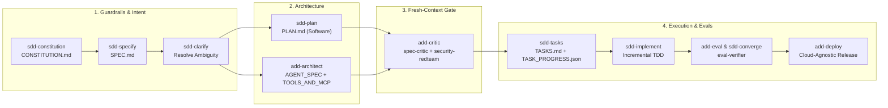

# Agentic SDLC (`asdlc`)

[](LICENSE)
[](pyproject.toml)
[](pyproject.toml)
[](#universal-compatibility)
[](#universal-compatibility)

**Stop "vibe coding" production systems.**
`agentic-sdlc` unites **Spec-Driven Development (SDD)** for deterministic software engineering and **Agent-Driven Development (ADD)** for deterministic AI agent engineering into one lightweight, zero-dependency, vendor-neutral framework.

Works out of the box with **any LLM** (Gemini, Claude, OpenAI, Kimi, DeepSeek, Qwen, Mistral, Llama/Ollama), **any cloud or on-prem stack** (AWS, Azure, GCP, Kubernetes, Docker), **any AI agent SDK**, and **any coding assistant** (Claude Code, Cursor, GitHub Copilot, OpenAI Codex, Kimi CLI, Windsurf, Cline, Roo Code, Antigravity, or any `AGENTS.md`-compatible tool).

---

## Table of Contents

1. [Why Raw "Vibe Coding" Fails in Production](#1-why-raw-vibe-coding-fails-in-production)
2. [What Is Spec-Driven Development (SDD)?](#2-what-is-spec-driven-development-sdd)
3. [What Is Agent-Driven Development (ADD)?](#3-what-is-agent-driven-development-add)
4. [Why Combine SDD + ADD?](#4-why-combine-sdd--add)
5. [How the Lifecycle Works](#5-how-the-lifecycle-works)
6. [Universal Compatibility](#6-universal-compatibility)
7. [Quickstart](#7-quickstart)
8. [Bundled Skills & Context-Isolated Personas](#8-bundled-skills--context-isolated-personas)
9. [Repository Structure Created by `asdlc init`](#9-repository-structure-created-by-asdlc-init)
10. [Greenfield vs. Brownfield Workflows](#10-greenfield-vs-brownfield-workflows)
11. [CLI Reference](#11-cli-reference)
12. [Contributing & License](#12-contributing--license)

---

## 1. Why Raw "Vibe Coding" Fails in Production

Prompting an LLM in a chat window (*"Build me a multi-tenant billing API and an AI support agent"*) feels magical for the first 200 lines of code—and breaks down catastrophically by day three:

| Failure Mode | What Happens During Ad-Hoc Prompting | How `agentic-sdlc` Solves It |
| :--- | :--- | :--- |
| **Context Window Drift** | Decisions buried 80 messages ago vanish on compaction or session restart; the next prompt contradicts yesterday's schema. | **Filesystem as Source of Truth**: Living specs (`docs/sdlc/*.md`) and machine-readable state (`TASK_PROGRESS.json`) persist in Git across sessions and teammates. |
| **Implicit Assumptions** | Models silently invent auth rules, retry policies, and edge-case behavior instead of asking. | **Socratic Clarification (`sdd-clarify`)**: Surfaces high-impact ambiguities *before* architecture or code is written. |
| **LLM Self-Grading Bias** | Asking the same context window that wrote 1,000 lines of code *"Is this secure and complete?"* yields rubber-stamp approval. | **Context-Isolated Reviewers (`add-critic`, `add-eval`)**: Independent `spec-critic`, `security-redteam`, and `eval-verifier` personas audit artifacts in fresh contexts with zero chat-history bias. |
| **Non-Deterministic Agent Sprawl** | AI agents ship with vague tool docstrings, shared mutable state collisions, unbounded loops, and zero prompt-injection defenses. | **Agent-Specific Contracts (`AGENT_SPEC.md`, `TOOLS_AND_MCP.md`, `EVAL_AND_SAFETY.md`)**: Enforces disjoint routing, `max_iterations`, typed tool error contracts, and golden trajectory evaluations. |

---

## 2. What Is Spec-Driven Development (SDD)?

**Spec-Driven Development (SDD)** inverts traditional AI-assisted coding: instead of treating code as the primary artifact and prompts as throwaway scratchpads, **version-controlled specifications become the executable contract** from which architecture, tests, and code are derived.

### How SDD Helps Software Teams
- **Shared Human + AI Alignment**: Product managers, tech leads, and coding agents review a concise `SPEC.md` (user stories + Gherkin Given/When/Then scenarios) and `PLAN.md` (architecture + API/data contracts) in minutes—catching design flaws when they cost 10 lines of Markdown rather than 5,000 lines of refactored code.
- **Deterministic Task Execution**: `sdd-tasks` breaks `PLAN.md` into small, dependency-ordered TDD units in `TASKS.md` and `TASK_PROGRESS.json`. Any engineer—or any coding agent—can pick up `T-007` cold and know exact inputs, target files, and test commands.
- **Zero "Last 15%" Drop-Off**: `sdd-converge` audits the finished codebase against every requirement ID in `SPEC.md`, generating delta tasks for any unbuilt edge cases.

---

## 3. What Is Agent-Driven Development (ADD)?

**Agent-Driven Development (ADD)** extends specification discipline to systems where **an LLM is part of the runtime**—single-agent assistants, multi-agent graphs, RAG workflows, tool suites, and Model Context Protocol (MCP) servers.

### Why Traditional Software Specs Aren't Enough for AI Agents
Traditional CRUD microservices are deterministic: `f(x)` always returns `y`. Autonomous AI agents are **probabilistic reasoning loops**:
1. **A tool's schema and docstring ARE its UI for the LLM.** Poorly phrased docstrings or raw stack traces cause tool-routing hallucinations and retry storms.
2. **Multi-agent handoffs fail on state & routing collisions.** Overlapping subagent descriptions cause routing ping-pong; dumping full chat transcripts between subagents blows up latency, cost, and accuracy.
3. **`pytest` alone cannot prove an agent works.** Passing unit tests on helper functions does not prove the model chooses the right tool sequence, stops at `max_iterations`, or resists indirect prompt injection hidden inside retrieved documents.

### How ADD Solves This
- **`AGENT_SPEC.md`**: Locks minimal viable agent topology, mutually exclusive subagent routing triggers, typed session state keys, `max_iterations` caps, and human-in-the-loop gates for destructive actions.
- **`TOOLS_AND_MCP.md`**: Defines typed parameter schemas, *when-to-call / when-not-to-call* docstrings, timeouts, payload truncation limits, and structured recoverable error JSON.
- **`EVAL_AND_SAFETY.md`**: Establishes a 4-layer evaluation bar—offline tool contract tests, golden multi-turn trajectories (portable across Gemini, Claude, OpenAI, Kimi, or local models), failure-recovery tests, and OWASP LLM prompt-injection red-teaming.

---

## 4. Why Combine SDD + ADD?

Real-world AI products are rarely "just an API" or "just a prompt." Almost every production system combines **deterministic software infrastructure (SDD)**—APIs, databases, queues, UIs, auth—with **probabilistic AI capabilities (ADD)**—agents, tools, MCP servers, and evaluations.

| Dimension | SDD Track (`--mode sdd`) | ADD Track (`--mode add`) | Unified Track (`--mode full`) |
| :--- | :--- | :--- | :--- |
| **Best For** | Backend APIs, CLIs, web/mobile apps, data pipelines, libraries | Standalone AI agents, multi-agent systems, RAG, MCP servers | End-to-end AI-native products (UI + API + DB + AI Agents) |
| **Core Contracts** | `CONSTITUTION.md`, `SPEC.md`, `PLAN.md`, `TASKS.md` | `CONSTITUTION.md`, `AGENT_SPEC.md`, `TOOLS_AND_MCP.md`, `EVAL_AND_SAFETY.md`, `TASKS.md` | **All of the above** under one unified `docs/sdlc/` graph |
| **Verification** | Unit, contract, integration, and E2E tests | Tool contract tests, golden trajectories, prompt-injection red-team | Full software + agent trajectory traceability |

---

## 5. How the Lifecycle Works



---

## 6. Universal Compatibility

`agentic-sdlc` has **zero vendor lock-in**. Switch models, clouds, frameworks, or IDEs at any time without rewriting your specifications or evaluation datasets.

| Layer | Supported Ecosystem |
| :--- | :--- |
| **LLMs / Foundation Models** | Google **Gemini**, Anthropic **Claude**, **OpenAI** (GPT / o-series), Moonshot **Kimi**, **DeepSeek**, Alibaba **Qwen**, **Mistral**, Meta **Llama**, local **Ollama / vLLM / LiteLLM** |
| **Agent Frameworks & Protocols** | **LangGraph**, **CrewAI**, **OpenAI Agents SDK**, **Anthropic Claude Agent SDK**, **Google ADK**, **AutoGen**, **PydanticAI**, **LlamaIndex**, **Model Context Protocol (MCP)**, or custom ReAct loops |
| **Clouds & Runtimes** | **AWS** (Bedrock, ECS, EKS, Lambda), **Azure** (AI Foundry, Container Apps, AKS), **Google Cloud** (Vertex AI, Cloud Run, GKE), **Kubernetes**, **Docker**, bare-metal / air-gapped on-prem |
| **AI Coding Assistants** | **Claude Code** (`.claude/`), **Cursor** (`.cursor/rules/`), **GitHub Copilot** (`.github/prompts/`), **OpenAI Codex**, **Kimi CLI**, **Windsurf** (`.windsurfrules`), **Cline / Roo Code**, **Antigravity**, and any tool supporting **`AGENTS.md` + `.agents/skills/`** |

---

## 7. Quickstart

### Install the CLI

Requires Python 3.11+ and **zero external runtime dependencies**:

```bash
# Recommended: install globally via uv or pipx
uv tool install git+https://github.com/dotsd/agentic-sdlc.git

# Or with pipx
pipx install git+https://github.com/dotsd/agentic-sdlc.git

# Or from a local clone
git clone https://github.com/dotsd/agentic-sdlc.git
uv tool install ./agentic-sdlc
```

### Initialize Any Project

```bash
# 1. Full SDD + ADD stack with universal AGENTS.md + .agents/skills/
asdlc init ./my-product --mode full --agent universal

# 2. Pure software service (SDD only) configured for Claude Code
asdlc init ./billing-service \
  --mode sdd \
  --agent claude \
  --stack "Python 3.12, FastAPI, PostgreSQL"

# 3. Pure multi-agent / MCP system (ADD only) across all IDE/agent adapters
asdlc init ./research-agent \
  --mode add \
  --agent all \
  --llm "Claude / Gemini / Kimi via LiteLLM" \
  --stack "Python 3.12, LangGraph, MCP"
```

### Check Progress & Validate Contracts

```bash
asdlc status ./my-product
asdlc validate ./my-product
asdlc list-skills
```

---

## 8. Bundled Skills & Context-Isolated Personas

### 12 Unified Skills

| Skill | Track | Artifact(s) Produced / Updated | Purpose |
| :--- | :---: | :--- | :--- |
| `sdd-constitution` | Shared | `CONSTITUTION.md`, `adr/ADR-0001-*.md` | Lock non-negotiable stack, typing, testing, security, and model rules |
| `sdd-specify` | SDD | `SPEC.md` | Author user stories, Gherkin Given/When/Then criteria, SLOs, and non-goals |
| `sdd-clarify` | Shared | `SPEC.md` / `AGENT_SPEC.md` | Socratic interview (max 5 high-impact questions) to eliminate ambiguity |
| `sdd-plan` | SDD | `PLAN.md` | Design deterministic module layout, Mermaid diagrams, data & API contracts |
| `add-architect` | ADD | `AGENT_SPEC.md`, `TOOLS_AND_MCP.md` | Design agent topology, disjoint routing, state keys, `max_iterations`, & tool schemas |
| `add-critic` | Shared | Defect Report -> Spec/Code fixes | Spawn fresh-context `spec-critic` + `security-redteam` reviews; block on P0/P1 |
| `sdd-tasks` | Shared | `TASKS.md`, `TASK_PROGRESS.json` | Decompose designs into atomic, dependency-ordered TDD tasks (`[P]` parallelizable) |
| `sdd-implement` | Shared | Source + Tests + `TASK_PROGRESS.json` | Execute tasks incrementally (Red -> Green -> Refactor) while syncing state |
| `add-eval` | ADD | `EVAL_AND_SAFETY.md` + `evals/` | Build & run tool contract tests, golden trajectories, and prompt-injection checks |
| `sdd-converge` | Shared | `TASKS.md`, `TASK_PROGRESS.json` | Audit spec-to-code traceability and append delta tasks until 100% converged |
| `add-deploy` | Shared | Packaging & Release Checklist | Verify secrets externalization, OpenTelemetry tracing, healthchecks, & rollback |
| `sdlc-sync` | Shared | `docs/sdlc/*` | Reverse-engineer existing brownfield repos into living specs & flag drift |

### 4 Context-Isolated Personas (`agents/`)

1. **`sdlc-orchestrator`** — Master coordinator keeping `docs/sdlc/` synchronized and routing phases cleanly.
2. **`spec-critic`** — Fresh-context read-only Principal Architect auditing requirements, API schemas, routing overlaps, and loop bounds (`P0`/`P1`/`P2`).
3. **`security-redteam`** — Fresh-context OWASP Web/API Top 10 + OWASP LLM/Agentic Top 10 security auditor (prompt injection, excessive agency, SSRF, path traversal, secret leaks).
4. **`eval-verifier`** — Fresh-context verification engineer executing test suites and golden agent trajectories without weakening assertions or silently patching prod code.

---

## 9. Repository Structure Created by `asdlc init`

```text
your-project/
├── AGENTS.md                          # Universal coding-agent instructions
├── .agents/
│   ├── skills/<skill-name>/SKILL.md   # Open Agent Skills (Codex, Kimi, Cline, Cursor, etc.)
│   └── agents/<persona>.md            # Fresh-context reviewer personas
├── .claude/                           # Optional (--agent claude | all)
│   ├── commands/<skill-name>.md       # Slash commands (/sdd-specify, /add-architect, ...)
│   └── agents/<persona>.md            # Native isolated subagents
├── .cursor/rules/agentic-sdlc.mdc     # Optional (--agent cursor | all)
├── .github/prompts/*.prompt.md        # Optional (--agent copilot | all)
├── .windsurfrules                     # Optional (--agent windsurf | all)
└── docs/sdlc/                         # Version-controlled living state
    ├── CONSTITUTION.md
    ├── SPEC.md                        # SDD & Full modes
    ├── PLAN.md                        # SDD & Full modes
    ├── AGENT_SPEC.md                  # ADD & Full modes
    ├── TOOLS_AND_MCP.md               # ADD & Full modes
    ├── EVAL_AND_SAFETY.md             # ADD & Full modes
    ├── TASKS.md
    ├── TASK_PROGRESS.json
    └── adr/
        └── ADR-0001-architecture.md
```

---

## 10. Greenfield vs. Brownfield Workflows

### Starting a Brand-New Project (Greenfield)
1. Run `asdlc init . --mode full --agent all`
2. In your AI coding assistant, invoke **`sdd-constitution`** -> **`sdd-specify`** -> **`sdd-clarify`**.
3. Run **`sdd-plan`** (for services/APIs/UI) and/or **`add-architect`** (for agents/tools/MCP).
4. Run **`add-critic`** to audit specs in fresh subagent contexts before writing code.
5. Run **`sdd-tasks`** -> **`sdd-implement`** -> **`add-eval`** -> **`sdd-converge`** -> **`add-deploy`**.

### Onboarding an Existing Codebase (Brownfield)
1. Run `asdlc init . --mode full` inside your existing repository (non-destructive; never overwrites existing files unless `--force` is passed).
2. Invoke **`sdlc-sync`** in your coding agent to reverse-engineer real modules, APIs, prompts, and tools into `docs/sdlc/` and surface architectural/security gaps.
3. Run **`add-critic`** and **`sdd-implement`** to close prioritized gaps safely with TDD.

---

## 11. CLI Reference

| Command | Description |
| :--- | :--- |
| `asdlc init [path] [--mode sdd\|add\|full] [--agent universal\|claude\|cursor\|copilot\|windsurf\|all] [--llm ...] [--stack ...] [--force]` | Scaffold `docs/sdlc/` templates and coding-agent adapters (`agentic-sdlc` alias also available) |
| `asdlc status [path] [--json]` | Report task completion metrics from `TASK_PROGRESS.json` and living document health |
| `asdlc validate [path]` | Validate required `docs/sdlc/` files, task status schema, missing dependencies, and dependency cycles (non-zero exit on failure; ideal for CI) |
| `asdlc list-skills` | Print all 12 bundled skills and 4 context-isolated personas |

---

## 12. Contributing & License

Contributions adding adapters, evaluation examples, or skill refinements are welcome—see [CONTRIBUTING.md](CONTRIBUTING.md).

Licensed under the [MIT License](LICENSE).
