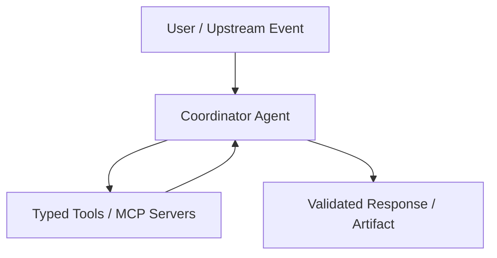

# AI Agent Architecture Specification — agentic-sdlc

> **Track**: Agent-Driven Development (ADD) | **Model Policy**: `Model-agnostic (Gemini, Claude, OpenAI, Kimi, DeepSeek, Qwen, Mistral, Local)` | **Last Updated**: `2026-11-10`

## 1. Topology Pattern & Justification
Select the simplest architecture that meets accuracy and latency goals:
- [ ] Deterministic Workflow + Structured LLM Output
- [x] Single Tool-Using Agent (`max_iterations = 8`)
- [ ] Supervisor / Router + Disjoint Subagents
- [ ] Generator + Isolated Critic Loop (`max_iterations = 3`)

## 2. Agent & Subagent Registry
| Agent ID | Model Tier (Env Var) | Persona & Responsibility | Exact Trigger Condition | Explicit Out-of-Scope / Non-Trigger | Max Iterations |
| :--- | :--- | :--- | :--- | :--- | :--- |
| `main_agent` | `MODEL_PRIMARY` | Primary domain orchestrator | All validated user requests | Direct unapproved destructive mutations | `8` |

## 3. Session & Memory State Contract
> Pass typed state keys or artifact URIs between subagents—never dump raw chat histories across boundaries.

| State Key | Type | Single Writer | Readers | Lifecycle / TTL |
| :--- | :--- | :--- | :--- | :--- |
| `request_context` | `dict[str, Any]` | Entrypoint | `main_agent` | Per-turn |
| `verified_result` | `ResultSchema` | `main_agent` | Response formatter | Per-session |

## 4. Termination, Fallback & Human-in-the-Loop Gates
- **Loop Exhaustion (`max_iterations` reached)**: Return partial verified findings with explicit status `"incomplete_max_iterations"` instead of hanging.
- **High-Impact / Destructive Actions**: Require deterministic policy check + explicit human confirmation before execution.
