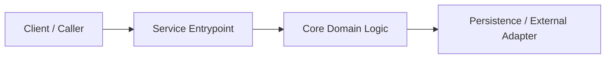

# Technical Architecture Plan — agentic-sdlc

> **Track**: Spec-Driven Development (SDD) | **Stack**: `Python 3.11+ standard library, Hatchling, Markdown/JSON contracts` | **Last Updated**: `2026-11-10`

## 1. Architecture Overview



## 2. Module & Directory Layout
```text
src/
  api/          # Transport & input validation layer
  domain/       # Pure deterministic business logic
  adapters/     # Database, storage, external HTTP/queue clients
tests/
  unit/
  integration/
```

## 3. Data Models & Persistence Contracts
| Entity | Key Fields & Types | Constraints / Indexes | Lifecycle / Retention |
| :--- | :--- | :--- | :--- |
| `ExampleEntity` | `id: UUID`, `created_at: datetime` | Primary key on `id` | Standard retention |

## 4. Interface & Error Contracts
- **Endpoints / CLI Commands**: Request/response schemas, status codes, timeouts, pagination.
- **Structured Error Format**: `{"error_code": "...", "message": "...", "request_id": "..."}`.

## 5. Verification & Test Mapping
| Requirement ID | Test Layer | Target Test File |
| :--- | :--- | :--- |
| `US-001` | Unit + Integration | `tests/test_example.py` |
